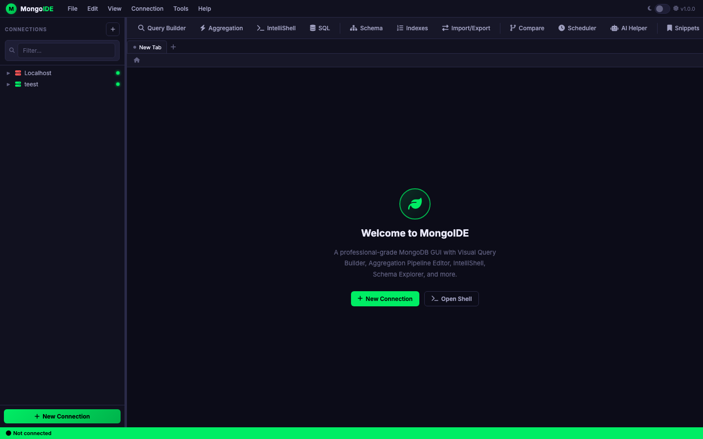
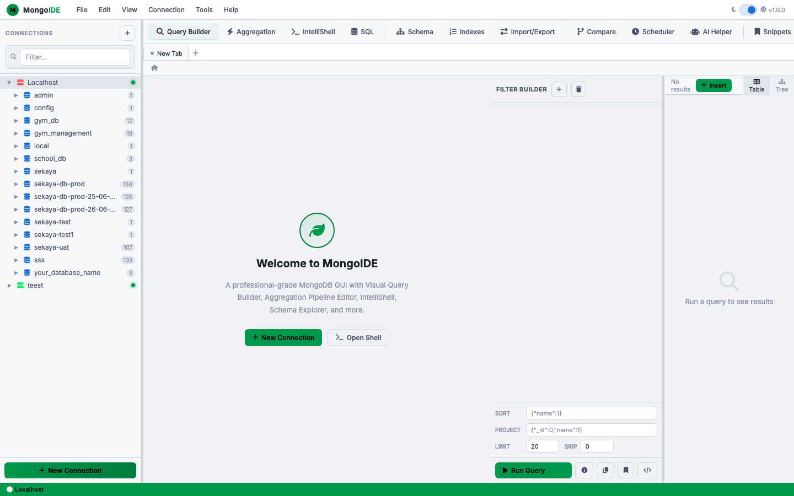

# MongoIDE

A professional, browser-based MongoDB GUI built with Flask and vanilla JavaScript — no Electron, no npm, no build step.


---

## Features

| Category | Feature |
|----------|---------|
| **Connections** | Multiple named connections, auto-connect, color labels, persistent storage |
| **Query Builder** | Visual filter builder, sort, projection, pagination, explain plan |
| **Aggregation** | Pipeline stage editor with live results |
| **IntelliShell** | MongoDB shell with autocomplete and history |
| **SQL Translator** | Write SQL, get the MongoDB equivalent + run it |
| **Schema Explorer** | Field types, coverage %, sampled from live data |
| **Index Manager** | View, create, and drop indexes |
| **Import / Export** | JSON, CSV, and XLSX — import into any collection or export results |
| **Collection Compare** | Diff two collections across connections |
| **Query Scheduler** | Schedule and replay saved queries |
| **AI Helper** | Claude-powered assistant for writing queries and pipelines |
| **Code Export** | Convert any query or pipeline to Python (pymongo), Node.js, or Java driver code |
| **Snippets Library** | Save and reuse named queries, pipelines, and shell commands |
| **Multi-tab Interface** | Open multiple collections or queries simultaneously |
| **Diff View** | Side-by-side document comparison before saving an edit |
| **Theme** | Dark / light toggle, persisted across sessions |
| **Resize Panels** | Draggable dividers on all split-pane panels |

---

## Screenshots

> Dark theme (default)



> Light theme



---

## Quick Start

### 1. Clone

```bash
git clone https://github.com/abdallahsitech/mongo-ide.git
cd mongo-ide
```

### 2. Install dependencies

```bash
pip install -r requirements.txt
```

### 3. Set your Anthropic API key

```bash
cp .env.example .env
# Edit .env and paste your key
```

> The AI Helper requires an [Anthropic API key](https://console.anthropic.com/). All other features work without it.

### 4. Run

```bash
python app.py
```

Open **http://localhost:8080** in your browser.

---

## Configuration

| File | Purpose |
|------|---------|
| `.env` | `ANTHROPIC_API_KEY` — required for AI Helper only |
| `connections.json` | Auto-created on first use; stores connection names and URIs |

> `connections.json` is excluded from git (see `.gitignore`). It may contain sensitive MongoDB URIs — keep it local.

---

## Tech Stack

| Layer | Technology |
|-------|-----------|
| Backend | Python 3.9+, Flask 3, PyMongo 4 |
| Frontend | Vanilla JS, CSS custom properties — zero framework, zero build |
| AI | Anthropic Claude API (streaming SSE) |
| Data | openpyxl (XLSX import/export) |

---

## Project Structure

```
mongo-ide/
├── app.py               # Flask backend — all API routes
├── templates/
│   └── index.html       # Single-file SPA — all HTML, CSS, JS
├── requirements.txt
├── .env.example
└── .gitignore
```

---

## Running in Production

This app uses Flask's development server by default. For production, run behind a proper WSGI server:

```bash
pip install gunicorn
gunicorn -w 2 -b 0.0.0.0:8080 app:app
```

---

## License

MIT
